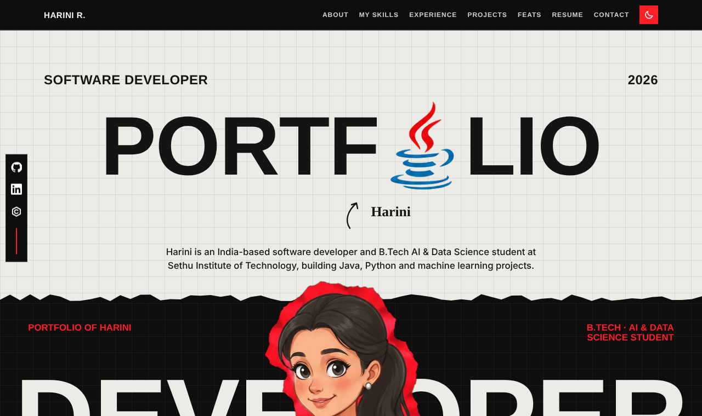
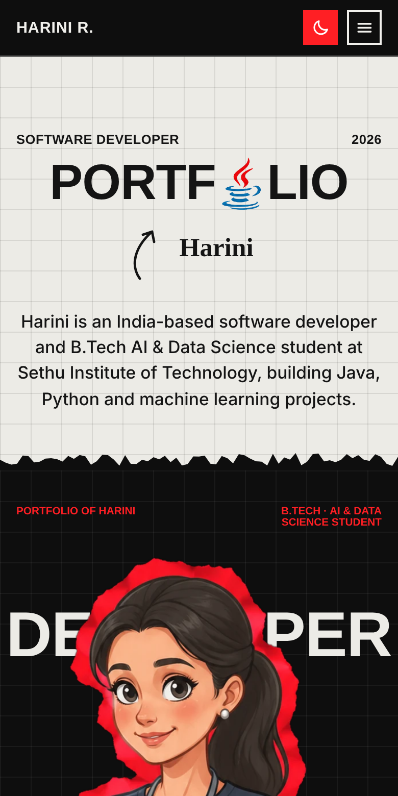

# Harini R — Portfolio

Personal portfolio of **Harini R**, a B.Tech AI & Data Science student (Sethu Institute of Technology, 2024–2028) who builds Java, Python and machine learning projects.

A single static page: no build step, no framework, no dependencies to install.





## Pages

| Page | What's in it |
| --- | --- |
| **Home** | Hero, page index, and the contact section ("Let's talk") at the bottom |
| **About** | Education, coursework, languages |
| **My Skills** | Languages, frameworks, tools, CS fundamentals |
| **Experience** | QSkill web development internship, Forage GenAI data analytics program |
| **Projects** | TerraMind-X, LedgerTrue, Razorpay Clone (slider, 2 per slide) |
| **Feats** | Smart India Hackathon 2026 finalist, PayPal AI Hackathon, certificates, practice profiles |
| **Resume** | Summary plus PDF download |

## Features

- Hash-based page routing in vanilla JS (`#about`, `#projects`, `#contact`, ...), so links are shareable
- Light and dark theme: follows the system setting, with a toggle that remembers your choice
- Responsive navigation: stays on one row when it fits and collapses into a menu when it doesn't
- Projects slider with arrow-key support, and an image lightbox
- Skip link, focus handling and `prefers-reduced-motion` support
- Resume PDF embedded in the page, so it downloads even when offline

## Tech

HTML · CSS · vanilla JavaScript. Fonts (Archivo, Caveat, DM Sans) load from Google Fonts.

## Project structure

```
.
├── index.html        # the whole site (markup, styles, scripts, embedded images)
├── og-preview.png    # social share preview image (1200x630)
├── screenshots/      # images used in this README
├── .nojekyll         # tells GitHub Pages to serve files as-is
├── .gitignore
├── LICENSE
└── README.md
```

## Run locally

Open `index.html` in a browser, or serve the folder:

```bash
python -m http.server 8000
# then visit http://localhost:8000
```

## Deploy

**GitHub Pages:** push the repo, then go to *Settings → Pages → Build and deployment*, choose *Deploy from a branch*, select `main` and `/ (root)`.

**Netlify / Vercel / Cloudflare Pages:** import the repo; no build command, publish directory is the repo root.

After you have the live URL, finish the social preview setup. In the `<head>` of `index.html`, add:

```html
<meta property="og:url" content="https://YOUR-SITE/">
<link rel="canonical" href="https://YOUR-SITE/">
```

and change `og:image` from `og-preview.png` to the absolute URL (`https://YOUR-SITE/og-preview.png`), because most platforms ignore relative image paths.

## Customising

- Each page is a `<div data-page="...">` inside `<main>`. Edit the text directly.
- Colours and fonts are CSS variables at the top of the `<style>` block (`--red`, `--blk`, `--paper`, `--ink`, `--disp`).
- To add a page, add a `data-page` block, add its name to the `pages` array in the router script, and link to it with `href="#name"`.

## Contact

- Email: [rharini938@gmail.com](mailto:rharini938@gmail.com)
- GitHub: [@hariniqo](https://github.com/hariniqo)
- LinkedIn: [harini-r0712](https://www.linkedin.com/in/harini-r0712/)

## License

Code is released under the [MIT License](LICENSE). Personal content (text, photos, logos, resume, certificates) is not covered by it.
